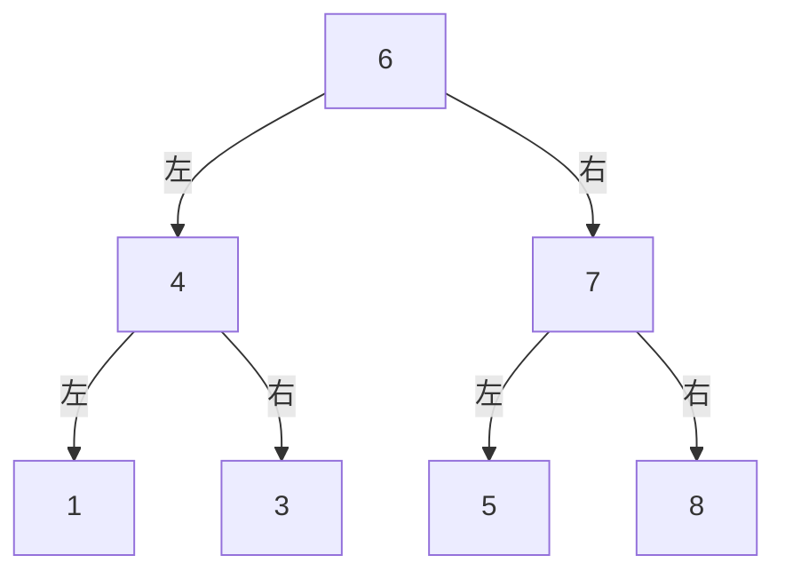

## 定义

### 满二叉树
### 完全二叉树
### 二叉搜索树
### 平衡二叉搜索树
### 二叉树高度
    
    深度（depth）：节点往上数，到根的边 / 节点数
    方向：**自顶向下**
### 二叉树深度

    高度（height）：节点往下数，到最远叶子的边 / 节点数
    方向：**自底向下**
## 二叉树的遍历

### 前序
**中 -> 左 -> 右**，按顺序遍历
上面的遍历结果: 6 4 1 3 7 5 8
### 中序
**左 -> 中 -> 右**，按顺序遍历
上面的遍历结果: 1 4 3 6 5 7 8
### 后序
**左 -> 右 -> 中**，按顺序遍历
上面的遍历结果: 1 3 4 5 8 7 6

## 深度优先搜索DFS
    
    更适合递归遍历，用栈来遍历

## 广度优先搜索BFS

    层序遍历， 使用队列
